<!--
  Generated by the Go app in this repo (see SETUP.md) on a GitHub Actions schedule.
  Edit templates/README.md.tmpl and config.json — changes made here are overwritten.
-->

<picture><source media="(prefers-color-scheme: dark)" srcset="assets/profile-dark.svg"><source media="(prefers-color-scheme: light)" srcset="assets/profile-light.svg"></picture>

<picture><source media="(prefers-color-scheme: dark)" srcset="assets/about-dark.svg"><source media="(prefers-color-scheme: light)" srcset="assets/about-light.svg"></picture>

<a href="https://github.com/Demoniskk/nrk-rss"><picture><source media="(prefers-color-scheme: dark)" srcset="assets/repo-nrk-rss-dark.svg"><source media="(prefers-color-scheme: light)" srcset="assets/repo-nrk-rss-light.svg"></picture></a>
<a href="https://github.com/Demoniskk/Igniter"><picture><source media="(prefers-color-scheme: dark)" srcset="assets/repo-igniter-dark.svg"><source media="(prefers-color-scheme: light)" srcset="assets/repo-igniter-light.svg"></picture></a>
<a href="https://github.com/Demoniskk/cs2-stats-discord-widget"><picture><source media="(prefers-color-scheme: dark)" srcset="assets/repo-cs2-stats-discord-widget-dark.svg"><source media="(prefers-color-scheme: light)" srcset="assets/repo-cs2-stats-discord-widget-light.svg"></picture></a>
<a href="https://github.com/Demoniskk/shelter-free-screen-share"><picture><source media="(prefers-color-scheme: dark)" srcset="assets/repo-shelter-free-screen-share-dark.svg"><source media="(prefers-color-scheme: light)" srcset="assets/repo-shelter-free-screen-share-light.svg"></picture></a>

<picture><source media="(prefers-color-scheme: dark)" srcset="assets/toolbox-dark.svg"><source media="(prefers-color-scheme: light)" srcset="assets/toolbox-light.svg"></picture>

<picture><source media="(prefers-color-scheme: dark)" srcset="assets/languages-dark.svg"><source media="(prefers-color-scheme: light)" srcset="assets/languages-light.svg"></picture>

<picture><source media="(prefers-color-scheme: dark)" srcset="assets/activity-dark.svg"><source media="(prefers-color-scheme: light)" srcset="assets/activity-light.svg"></picture>

Last refreshed Tuesday 20 October 2026 at 07:02 Oslo time (CEST) 
Stats and cards are rebuilt every 6 hours by a small Go program running on GitHub Actions · <a href="SETUP.md">How it works</a>

